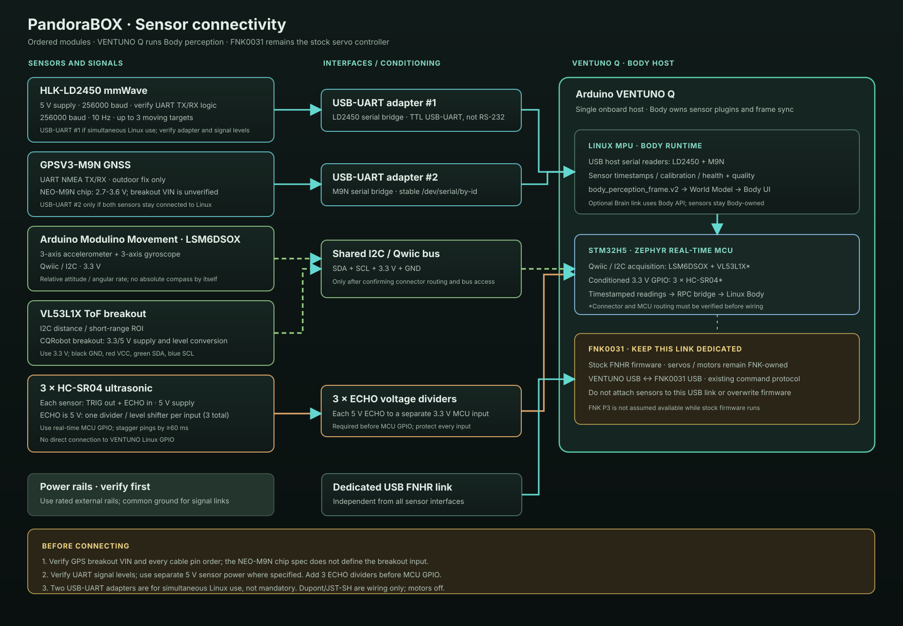

# Body sensor bring-up: VENTUNO Q + FNK0031

## Hardware in the delivery

| Module | First connection target | Body role | Important constraint |
| --- | --- | --- | --- |
| HLK-LD2450 | VENTUNO Q Linux via USB-UART, or MCU UART with a data-forwarding sketch | Up to 3 moving metric targets | 5 V supply (>200 mA), 256000 baud, 10 Hz; official manual states PA9 is 3.3 V but does not specify UART TX/RX logic in text; verify those pins |
| Arduino Modulino Movement (LSM6DSOX) | VENTUNO Q Qwiic / MCU I2C | 3-axis acceleration and gyro | Qwiic is 3.3 V; Qwiic pin order is GND, 3V3, SDA, SCL |
| GPSV3-M9N | VENTUNO Q Linux via USB-UART, or MCU UART with a data-forwarding sketch | Outdoor GNSS/map anchor | NEO-M9N chip is 2.7-3.6 V; exact GPSV3 breakout regulator and I/O level are unverified, so identify its VIN label before power |
| CQRobot VL53L1X (B07F3TV3G4 / CQRWX00744US), quantity 1 ordered | VENTUNO Q Qwiic / MCU I2C | Short-range ToF distance/ROI | Recommended final layout uses 3 units; order 2 more. Give each module a separate XSHUT control so the MCU can assign unique I2C addresses at boot |
| 3 x HC-SR04 | VENTUNO Q real-time MCU GPIO, not Linux GPIO | Narrow-beam short-range range checks | 5 V supply; add one divider/level shifter per ECHO before each 3.3 V GPIO |
| Dupont and JST-SH leads | Wiring only | Prototyping | Connector fit does not guarantee matching pin order; verify every cable end-to-end |

The VENTUNO Q owns perception and sensor acquisition. Use its STM32 MCU for
time-sensitive GPIO/I2C acquisition and its Linux MPU for USB-UART readers,
timestamp validation, fusion and ROS 2 publication. The Arduino Router Bridge
is the intended MCU-to-Linux transport; it does not replace the Body Runtime.
The FNK0031 remains stock FNHR firmware and the motor/servo controller. Keep its existing USB link
reserved for the FNK protocol. Do not attach new UART devices to that serial
link, overwrite its firmware, or assume that the FNK P3 port is available while
stock firmware is running.

## Physical topology



For the pin-by-pin cable plan, including the HC-SR04 ECHO dividers, see
[BODY_SENSOR_WIRING.svg](BODY_SENSOR_WIRING.svg).

The first image is the architecture overview; the detailed wiring sheet gives
pin-to-pin routes for the documented interfaces. The GPS breakout input and
LD2450 UART levels remain explicitly unverified. Confirm board labels, signal
voltage, power source and connector pin order before plugging anything in.

```text
HLK-LD2450 -- USB-UART / Linux serial ---------------------┐
GPSV3-M9N -- USB-UART / Linux serial ----------------------┤
Modulino Movement + VL53L1X x3 -- Qwiic/I2C + MCU XSHUT ---┤
HC-SR04 x3 -- conditioned MCU GPIO, sequential pings ------┤
                                                           v
VENTUNO STM32 acquisition sketch -- Arduino Router Bridge --> Linux Body Runtime
  -> per-sensor samples with source, timestamp, frame, quality, error/stale state
  -> body_perception_frame.v2 / ROS 2 topics / UI / world model / Brain API
FNK0031 stock controller <------ dedicated USB FNHR command link
```

For initial UART tests, one USB-UART adapter can be moved between sensors;
two adapters are only needed to leave both connected to Linux simultaneously.
Use TTL USB-UART adapters (not RS-232). A 3.3 V adapter is the conservative
choice, but verify the sensor TX/RX logic and adapter pinout before connecting;
cross TX/RX and connect GND.
Keep sensor power separate from the adapter's VCC pin unless that exact board's
power input is confirmed. On Linux, configure stable `/dev/serial/by-id/...`
paths, not transient `/dev/ttyUSB0` numbering. The VENTUNO Q has two USB-A
ports, so using FNK USB, two adapters, and a USB camera together requires a hub
or a different acquisition route. Sensor grounds and VENTUNO ground must be
common for wired UART/GPIO signals.

For the CQRobot VL53L1X breakout (B07F3TV3G4), its published manual gives the
wire colors as black=GND, red=VCC, green=SDA, blue=SCL, yellow=SHUT, orange=INT
and claims 3.3/5 V level conversion. Prefer 3.3 V VCC on the VENTUNO Q. Each
unit starts at I2C address 0x29; three identical units cannot be left at that
address together. Keep all three XSHUT lines low, then enable one sensor at a
time, assign it a distinct address, and continue to the next. Keep those
addresses in configuration and reapply them after every MCU reset. Modulino
Movement defaults to 0x6A, so it does not collide with the ToF addresses. Verify
that the actual cable exposes SHUT and that the delivered module matches the
published board before wiring three units.

### Breadboard wiring: one ToF + three HC-SR04s

Use the VENTUNO Q **MCU/shield headers**, not the Linux GPIO or FNK0031. The
assignments below use D2-D6 and D9 for the six ultrasonic signals. D7/D8 remain
reserved for the LD2450 UART; change both the sketch and this table together if
another shield or sketch uses one of the selected pins.

| ToF lead / pin | Connect to |
| --- | --- |
| CQRobot black / GND | VENTUNO Q GND |
| CQRobot red / VCC | VENTUNO Q 3V3 |
| CQRobot green / SDA | VENTUNO Q Qwiic SDA (or the corresponding MCU I2C SDA pin) |
| CQRobot blue / SCL | VENTUNO Q Qwiic SCL (or the corresponding MCU I2C SCL pin) |
| CQRobot orange / INT | Leave disconnected for the first test |
| CQRobot yellow / SHUT | For this one-sensor test, leave unconnected only if the breakout holds it in its enabled state; otherwise use a verified 3.3 V pull-up/control connection. Do not let it float |

Use either the sensor's supplied cable or a Qwiic cable for SDA/SCL/power; do
not connect two power sources to the module. The ToF should appear at I2C
address `0x29`. The supplied cable's lead colors are vendor-specific: verify
the labels before power, even though they match the published CQRobot manual.

| HC-SR04 | VCC | GND | TRIG from MCU | ECHO to MCU through its own divider |
| --- | --- | --- | --- | --- |
| Left | VENTUNO +5V | common GND | D2 | D3 via divider #1 |
| Right | VENTUNO +5V | common GND | D4 | D5 via divider #2 |
| Rear | VENTUNO +5V | common GND | D6 | D9 via divider #3 |

Build each ECHO divider as a separate two-resistor branch on the breadboard:
HC-SR04 ECHO -> **1 kOhm** series resistor -> tap -> MCU input; from that same
tap, connect a **1.8 kOhm** resistor to GND. This scales a nominal 5 V ECHO
pulse to about 3.21 V, leaving margin below the 3.3 V rail. The pictured 1 kOhm
+ 2 kOhm pair yields about 3.33 V nominal; use the 1.8 kOhm lower resistor
instead for margin. Repeat for D3, D5 and D9; do not share divider taps. All
grounds must be common. Connect each TRIG directly to its assigned MCU output; the
VENTUNO MCU output is 3.3 V logic. Power the three HC-SR04 VCC pins from the
VENTUNO 5 V rail, not from a USB-UART adapter. Start with only one module and
one divider connected, confirm the ECHO tap stays at or below 3.3 V, then add
the other two. Trigger only one ultrasonic sensor at a time and leave at least
60 ms before triggering the next to reduce acoustic cross-talk.

Keep the sensor wires short and label each channel at both ends. The VENTUNO
STM32 bridge exposes `body_ultrasonic_read` for these three channels. Body reads
them at `/plugins/ultrasonic/status` and displays each fresh range in Live
Sensors. Missing echoes are not converted to zero-distance readings.

## Recommended ToF placement

Use two forward-facing VL53L1X units, one on each side of the centerline, with
only a mild outward angle (start around 10 degrees), plus one rear-facing unit
on the centerline. This preserves overlap near the forward centerline while
extending coverage to the front corners, and adds a dedicated reverse-clearance check. Keep
the front pair physically separated and do not put the LD2450 board, a lip, or
a transparent cover in their optical paths. The LD2450 belongs above the
forward pair; its wide-area moving-target tracks complement, rather than
replace, the ToF ranges. The third unit is not in the current order: purchase
two more before freezing the holder dimensions. Final yaw and mount coordinates
must be set from the actual carrier and verified with a ruler/target, not CAD
assumptions alone.

The GPSV3-M9N product listing identifies the receiver family but does not
provide a trustworthy schematic for the seller's breakout. The u-blox NEO-M9N
chip itself is 2.7-3.6 V and its I/O levels track VCC. Do not infer that the
breakout accepts 5 V from the chip specification: check the PCB's VIN marking
or seller schematic first, and use 3.3 V UART logic regardless.

The LD2450 reports X lateral, Y forward in millimetres, and signed velocity in
centimetres/second. Body converts these to metres and metres/second in a
sensor-local frame, then applies a measured mounting transform before fusion.
The M9N fix is geographic, not local-map odometry: only use it outdoors and
anchor/project it with its reported accuracy. The Modulino Movement gives
acceleration and angular rate; it does not provide absolute heading by itself.

## Acquisition plan and staged validation

`body_requirements.txt` already includes `pyserial`. The repository contains
LD2450 and NMEA parser groundwork, ROS 2 topic subscribers, and a
`body_perception_frame.v2` fusion contract. These are not direct readers for
the ordered physical sensors. The acquisition implementation still needs an
MCU sketch plus Linux Bridge client for I2C/GPIO, and Linux serial readers for
the two USB-UART sensors. Arduino publishes the Python Bridge client as
`arduino-router-bridge`; use the local Unix Router socket on the Ventuno, not an
unauthenticated LAN TCP endpoint.

| Sensor | Reader / initial policy | Body output and freshness rule |
| --- | --- | --- |
| 3 x VL53L1X (2 front + 1 rear) | STM32 via Qwiic; boot-time XSHUT/address assignment; start with staggered ranging | Three separate `sensor_msgs/Range` streams with range, min/max, FOV, frame, status and MCU timestamp; initial stale threshold 300 ms |
| Modulino Movement LSM6DSOX | STM32 via Qwiic; sample at 100 Hz, publish batched snapshots to Linux at 50 Hz | `sensor_msgs/Imu`; calibrated axes, monotonic timestamp, orientation covariance unknown until fused; stale after 100 ms |
| 3 x HC-SR04 | STM32 GPIO; one trigger/echo measurement at a time, at least 60 ms between triggers | Three separate Range streams, initial full round ~5 Hz per sensor; invalid/out-of-range is no-return, not zero distance; stale after 300 ms |
| HLK-LD2450 | Linux USB-UART at 256000 baud; continuous parser, bounded read buffer | `radar_msgs`-style Body target array with ID, position, velocity, frame and timestamp; reject malformed frames, stale after 300 ms |
| GPSV3-M9N | Linux USB-UART; NMEA checksum validation, start at receiver default baud after label/ID inspection | `sensor_msgs/NavSatFix`; no-fix is invalid, retain fix quality/HDOP/satellites, stale after 2 s |

The rates and stale thresholds above are starting settings, not measured
performance guarantees; tune them after the physical sensors arrive. Use a
monotonic clock for age checks, preserve sensor time separately where
available, and record both acquisition and receive timestamps. Each module
must have an independent online/offline/stale/error state and a per-device
calibration transform. Never substitute zero values for missing samples. The
MCU-to-Linux bridge should send small latest-value snapshots (plus counters),
not flood the Router with one RPC per raw sample. Linux then emits ROS topics
and joins the latest valid samples into the Body frame with their original
timestamps and per-source provenance.

1. Record exact breakout labels, cable pin order, device IDs and idle voltages.
2. Bring up the M9N outdoors alone; verify checksum-valid GGA/RMC, fix quality,
   satellites, HDOP and stale-data behavior.
3. Bring up LD2450 alone; validate signed X/Y and velocity using a person
   crossing left/right and approaching/receding at measured positions.
4. Connect Modulino Movement on Qwiic and verify raw axes, units, orientation
   and timestamping with stationary and hand-rotated tests.
5. Connect the Modulino and one VL53L1X alone; confirm the MCU acquisition
   route, I2C addresses and ruler readings.
6. Add the other two VL53L1X sensors one at a time. Verify unique addresses,
   cross-talk, each sensor's field of view and front/rear frame signs. Begin
   with staggered starts; increase overlap only if measurements show no
   optical interference.
7. Add one HC-SR04 through its own ECHO divider and validate echo timing. Then
   add the other two sequentially, keeping at least 60 ms between triggers to
   limit acoustic cross-talk.
8. Bring up each USB-UART sensor independently, then both concurrently. Save
   stable `/dev/serial/by-id` paths and confirm no conflict with the FNK port.
9. Enable fusion only after each modality reports source, timestamp, frame,
   calibration, quality and stale/error state in the Body UI.
10. Run stationary sensor-only tests, then hand-carried tests with motors
   disabled. Physical actuation remains confirmation-gated until calibration
   and stopping behavior have been measured.

## Acceptance gates

- FNK USB controller remains discoverable and retains its stock remote behavior.
- No 5 V signal reaches a 3.3 V-only pin; no sensor is powered from an
  unverified rail.
- Every sensor has an independently visible online/offline/stale/error state.
- LD2450 positions and relative velocity use a documented robot-frame
  transform; the transform is calibrated rather than guessed from cable or
  board orientation.
- GNSS reports fix quality and uncertainty; no-fix coordinates are never
  treated as a valid robot pose.
- IMU angular velocity is integrated only with drift/uncertainty represented;
  it is not presented as absolute planar heading.
- Simulation and physical sensor frames are visibly distinguished in UI and
  logs.
- The desired three-ToF layout is not considered installed until two more
  VL53L1X modules are obtained and the required three XSHUT wires are routed.

## References

- [VENTUNO Q Microcontroller Guide](https://docs.arduino.cc/tutorials/ventuno-q/mcu-examples/)
- [Arduino Router Bridge Python client](https://github.com/arduino/arduino-router-bridge-py)
- [ST VL53L1X multi-sensor 2D LiDAR example](https://www.st.com/en/embedded-software/stsw-img017.html)
- [ST VL53L1X datasheet](https://www.st.com/resource/en/datasheet/vl53l1x.pdf)
